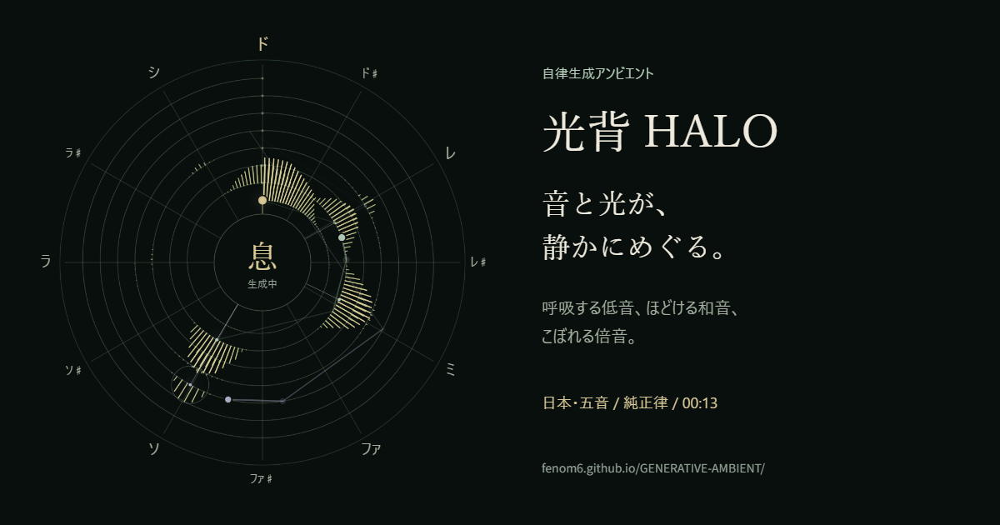

# 自律型光背 HALO — GENERATIVE AMBIENT

**[公開ページを開く](https://fenom6.github.io/GENERATIVE-AMBIENT/)**

根音・和声・倍音の3声部が、その場で音と光を編み続けるアンビエント試作です。**「音と光をはじめる」**を押すだけで始まり、同じボタンで止まります。小さな音からお楽しみください。



アプリの「光背を画像に保存」で書き出した一枚です。音声の録音ではありません。

## はじめて使う

1. [公開ページ](https://fenom6.github.io/GENERATIVE-AMBIENT/)を開き、「音と光をはじめる」を押します。
2. 好みで、凪（集中したいとき）・呼吸（くつろぎたいとき）・星明かり（光を楽しみたいとき）を選びます。
3. 終えるときは「音と光をとめる」を押します。詳細設定は触らなくても楽しめます。

**画面を開いている間だけ再生します。画面を消す・別のタブへ移ると停止します。** バックグラウンド再生には対応していません。画面点灯の維持は、対応端末で任意に使えます。

原作 [光背 HALO](https://fenom6.github.io/Halo/) の7オクターブの螺旋と千本の周波数光を引き継いでいます。

## 機能

- 根音は12〜20秒で呼吸し、2〜4分ごとに主音・五度・四度へ重心を移します。
- 和声は4〜8秒ごとに、直前の和音に応じた確率で1〜2音を選びます。
- 高音は2〜6秒ごとに、密度に応じて音階や自然倍音から1音を鳴らします。
- 純正律・平均律、日本の五音・インド風の五音・アラブ風の四分音を選べます。
- 密度、余韻、音量、各声部、5〜60分または時間指定なしを設定できます。
- マイクや外部音源を使わず、この端末で合成します。設定はブラウザー内に保存します。
- 生成記録の保存は、種・開始時設定・直近256音・停止理由などをJSONで保存します。録音ではありません。
- 低音は選択した主音を起点とする1オクターブに収め、光背の螺旋と同じ起点を使います。
- 光の軌跡は実際の経過秒数で消します。描画速度や「動きを減らす」設定で余韻が長くなりません。
- 光背の画像はPNGとして保存できます。画像にはその瞬間の光、音階・調律・経過時間を添えます。

純正律は周波数を5:4や3:2などの整数比で合わせる方式です。FFT（音を高さごとの強さに分ける計算）で光を描きますが、光が完全に静止する保証はありません。インド風・アラブ風は音階を参考にした簡易モデルで、伝統音楽全体の再現ではありません。

## 自律生成の範囲と停止

利用者が開始した間だけ、観測→選択→発音→再観測を繰り返します。同時発音は最大16音。画面非表示・音声中断・処理遅延・時間切れなどで停止し、自動復帰しません。音声回路にも更新が途絶えてから1.4秒以内に無音にする監視期限があります。

外部のTAS実行器とは未接続です。実際のスマートフォン、実タブ非表示、長時間再生、聴感については追加確認が必要です。医療・瞑想効果や、OS・音声機器の全故障に対する無音を保証するものではありません。

時間指定は各「はじめる」からの経過時間に適用します。例えば10分経過後に5分へ短縮すると、その場で終了します。

## スマートフォン向けの設定

「音と光をととのえる」に次の2項目があります。

- **音楽として再生（対応端末）**：対応する音声設定APIがある場合、開始時に `playback` にし、停止時に以前の設定へ戻します。音楽用の音声として扱う指定です。マナーモード中も鳴る場合がある一方、ほかの音楽再生を止める場合があります。初期オンですが、オフにして通常のブラウザー動作を選べます。再生中に切り替えると停止し、次の開始から反映します。
- **再生中は画面を点けたままにする**：初期オフです。オンにしたセッションの再生中だけ画面点灯の維持を要求し、停止時・非表示時・オフにしたときに解除します。低電力状態や端末の都合で拒否・解除された場合は画面に表示します。非表示後の音声再開や、画面点灯の維持の自動取得はしません。

未対応ブラウザーでは項目を無効表示し、通常の再生と停止を使えます。マイクへのアクセス、無音ファイルの再生による代替、バックグラウンド再生は追加していません。

監督から、**iPhoneの消音モードでも音が出た**との実機報告がありました。機種・iOS・ブラウザー・「音楽として再生」の設定・出力先は未記録です。画面点灯維持と、設定を変えた場合の比較は引き続き未確認です。

仕様の参照先：[WebKitのSafari 16.4の機能説明](https://webkit.org/blog/13966/webkit-features-in-safari-16-4/)、[W3C Audio Session](https://www.w3.org/TR/audio-session/)、[W3C Screen Wake Lock](https://www.w3.org/TR/screen-wake-lock/)。

## ローカル開発

Node.js 22以上。追加パッケージは不要です。

このリポジトリはビルド不要です。`dist/` は手書きのHTML・JavaScript・CSSと画像を置く配信ソースで、別の `src/` から生成していません。ソースとビルド成果物の二重管理はありません。

```powershell
npm test
npm run check
npm start
```

順に、自動試験、文法・原作ソースの一致確認、PC内の画面配信を実行します。`http://127.0.0.1:8787` を開きます。配信の終了はCtrl+Cです。

Windowsでは `光背を開く.cmd` のダブルクリックでも起動でき、配信が始まってから既定ブラウザーを開きます。`Start-Halo.ps1` は配信を始めるPowerShell版です。どちらも `npm start` と同じサーバーを使います。macOS・Linuxでは上記の `npm start` を使います。

## 自動試験で確かめること

- 音の生成：音域・周期・同時発音数、乱数の種による再現、主音と螺旋の座標の一致。
- 停止と端末機能：遅れて終わる開始や点灯維持の許可が、停止を覆さないこと。拒否・解除・解除失敗の扱い。
- 描画：更新速度が変わっても、光の軌跡が指定した秒数で消えること。

**[ブラウザーで音声の無音試験を開く](https://fenom6.github.io/GENERATIVE-AMBIENT/diagnostics.html)** と、スピーカーへ出力せず、発音と停止後の波形を計算できます。ローカル配信では `/diagnostics.html` を開きます。これは聴感や実機の確認を代わりに行うものではありません。

## 実機チェックの現在地

| 対象 | 確かめること | 状態 |
| --- | --- | --- |
| iPhone（ブラウザー未確認） | 消音モードでも音が出る | 監督の実機報告で確認。詳細条件は未記録 |
| iPhone / Safari | マナーモードON・OFFと「音楽として再生」ON・OFF | 組み合わせ比較は未実施 |
| iPhone / Safari | 画面点灯維持、手動ロック、アプリ切り替え、再開操作 | 未実施 |
| Android / Chrome | 通常・省電力時の再生、点灯維持、画面ロック | 未実施 |
| iPhone・Android | 5分・30分・60分の再生、時間終了と停止後の無音 | 未実施 |
| Windows / Chrome | 開始・手動停止、5分の連続生成と時間終了、画像保存、PC・スマホ幅の操作画面 | ローカルで確認（消音状態。実音は未確認） |

手順と記録欄は **[実機チェックリスト](docs/device-checklist.md)** にあります。端末・OS・ブラウザー・実測結果を記録し、未実施の欄を推測で埋めない運用です。

## アクセシビリティ

ボタンや設定はキーボードのTab・Enter・Spaceで操作でき、入力欄には名前と短い説明を付けています。音量と消音を分け、開始・停止の状態は文字でも示します。OS・ブラウザーの「動きを減らす」設定では描画の更新頻度を下げ、光の余韻は同じ秒数で保ちます。音を消して光だけを眺めることもできます。実際の読み上げ環境とスマートフォンでの使い勝手は追加確認が必要です。

## 調整する場所

- `dist/js/music.js`：音階、和音、周期、乱数の種による再現。
- `dist/js/audio.js`：音色、立ち上がり、残響、音声の停止。
- `dist/js/view.js`・`dist/style.css`：光の骨格、色、画面。
- `dist/js/session.js`：開始・停止の保持。
- `dist/js/timed-kouhai.js`：`kouhai` は「光背」のローマ字表記です。原作の描画を変えず、光の軌跡の寿命を秒数で管理します。
- `dist/js/mobile.js`：音声設定と画面点灯維持の取得・解除。停止後に届いた許可も解除する。

## 公開と復元

mainへのpush後、GitHub Actionsが自動試験とソース検査を実行してから `dist/` をGitHub Pagesへ公開します。失敗した更新は公開されず、直前の正常な公開版が残ります。不具合があれば原因のコミットをrevertし、同じ検証を通して再公開します。履歴の強制上書きは不要です。

試作の変更は **[CHANGELOG.md](CHANGELOG.md)** に残します。GitHubの公開タグ・Releasesは未作成です。

## 感想・不具合を伝える

[Issues](https://github.com/Fenom6/GENERATIVE-AMBIENT/issues)から「聴き心地・使い心地」を選べます。使った端末、音の設定、気になった点を教えてください。音声の録音を添付する必要はありません。

## 出典・ライセンス

MIT License / Copyright © 2026 Fenom6。
`dist/vendor/halo/` は [Fenom6/Halo](https://github.com/Fenom6/Halo) の固定版を未変更で取り込んでいます。版とファイルの識別値は `SOURCES.json`、原作のライセンスは `dist/vendor/halo/LICENSE` に保持しています。
